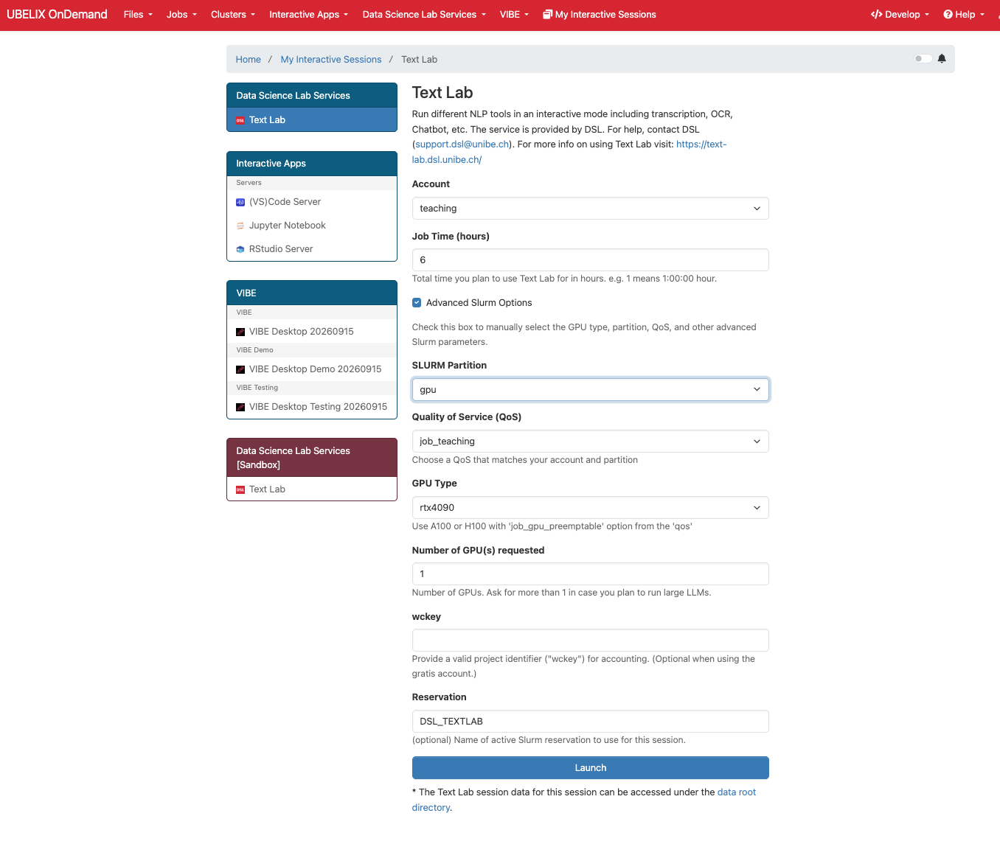

# Transferable Skills AI Tools
Program and material for the AI Methods and Tools for Research course organized by the Data Science Lab for the Transferable Skills Program.
More information about the Program and the course can be found [here](https://www.unibe.ch/forschung/dienstleistungen/akademische_laufbahnplanung/ts/ts_programm/index_ger.html).

In line with open science requirements, the [Data Science Lab (DSL)](https://www.dsl.unibe.ch/) at UniBE develops internal AI-powered research tools. During the course, DSL team members will present these tools and the principles behind them, which also apply to third-party software.

Additionally, a member of the Open Science Team will discuss the challenges and limitations involved in the use of proprietary tools when it comes to open science. 

The practical session will highlight the resources available at the University of Bern, and in parcticular the High Performance Computing Platform "Ubelix" that is hosting the TextLab collection of frameworks developed by the Data Science Lab Team. [Ubelix OnDemand](https://ondemand.hpc.unibe.ch/) can be accessed only with a valid UniBE account, and exclusively on the University network (use VPN if necessary).

# Schedule
|<b>Time</b>| <b>Topic</b>| <b>Trainers</b>| <b>Slides</b> |
|---| ---| ---| ---|
|09:00-09:15| **Course Objectives and learning outcome (Get to know each other)** | *Mykhailo Vladymyrov*|[link](https://docs.google.com/presentation/d/1sK1gBRwK0XGKE706jDD6zBTp1egg8kzjMAsdYTxxEBQ/edit?usp=sharing) |
|09:15-10:00| **AI literacy & Open Science - Good Practices** | *Federico Grasso Toro*| [link] (https://docs.google.com/presentation/d/1HpR88448Us1ooglCOm-TjB91bj0S7nQsrZ4AlAIMGdY/edit?usp=sharing) |
|10:00-10:45| **Introduction to Data Types, LLMs & AI Tools** | *Mykhailo Vladymyrov*|[link](https://docs.google.com/presentation/d/1X5AChP2c1gIm6JLQgJ69B_c-ADDoMtNeJFuGHeanD_I/edit?usp=sharing) |
|10:45-11:00| Break|||
|11:00-11:15| **Introduction to UBELIX**| *Matteo Boi*| [link](https://docs.google.com/presentation/d/1CFdUJtbSWbvt70ghigMz0Ld6xJ5eF_ZNM6eoYuAVp5Y/edit?usp=sharing)|
|11:15-12:15| **OCR & audio transcription**| *Matteo Boi*| [link](https://docs.google.com/presentation/d/1JsmwO5KYurXczhRqRaGEAEb8feOjNSqQIPKWqrPJeFs/edit?usp=sharing)|
|12:15-13:15| Lunch break|||
|13:15-13:45| **Topic Modeling**| *Ahmad Alhineidi*| [link](https://docs.google.com/presentation/d/1fDYmzTZlH1otqiwz_6BzzT7E3t7z2KcCCkT_q_Za1p0/edit?usp=sharing)|
|13:45-14:15| **Text processing tools**| *Ana Stojiljkovic*||
|14:15-14:45| **Data analysis with AI**| *Ahmad Alhineidi*|  [link](https://docs.google.com/presentation/d/1fDYmzTZlH1otqiwz_6BzzT7E3t7z2KcCCkT_q_Za1p0/edit?usp=sharing)|
|14:45-15:00| Break|||
|15:00-15:30| **Knowledge Graph**| *Ana Stojiljkovic*| [link](https://docs.google.com/presentation/d/1dC3XcaPVLNrJ6C5g3BAcZsA7AbtNZfjXvHWWeIMu6Jc/edit?usp=sharing)
|15:30-16:45| **Q&A and workshop**| *Ahmad Alhineidi and Ana Stojiljkovic*||
|16:45-17:00| **Closing remarks**| *Ahmad Alhineidi and Ana Stojiljkovic*||

# Textlab
To start Textlab, please use the reservation for this course `reservation=DSL_TEXTLAB` on [Ondemand](https://ondemand.hpc.unibe.ch/). 
See the image below for example. 

## Hands-on: OCR & audio transcription
1. Download **all sample files in one go**: [materials/all_sample_files.zip](https://github.com/dsl-unibe-ch/Transferable_Skills_AI_Tools/raw/main/materials/all_sample_files.zip)
2. Follow the exercise sheet: [materials/EXERCISES_part1.md](materials/EXERCISES_part1.md)

## Hands-on: Text Processing
1. Follow the exercise sheet: [materials/EXERCISES_part2.md](materials/EXERCISES_part2.md)

The sample files are synthetic: computer-generated voices and a fictional article, so they are free to use and share.
Text Lab documentation: <https://text-lab.dsl.unibe.ch>

Text Lab survey. Please fill (2 min) [link](https://forms.gle/MrmvcurPuHMC9oMN7)

Transferable skills survey [link](https://ilias.unibe.ch/go/svy/2775745)
